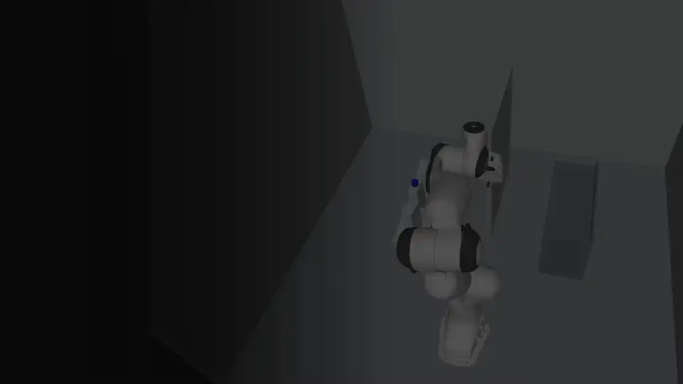
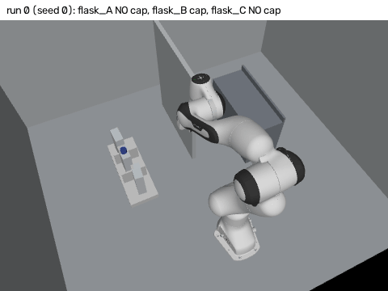
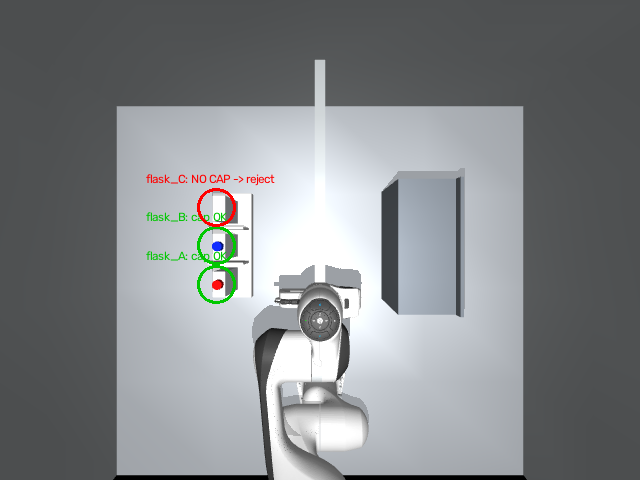
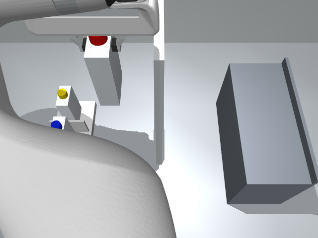
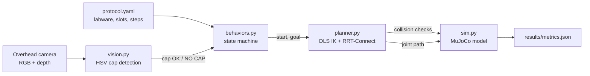

<div align="center">

# Cell Culture Workcell Digital Twin

**A robot arm in a tight lab hood that checks every flask cap before it touches the flask.**

A MuJoCo simulation: a Franka Panda moves T75-sized flasks from a rack to an incubator shelf inside a box-shaped hood.
It follows a YAML lab protocol, plans every move with RRT-Connect and full collision checking, and uses an overhead
camera with OpenCV to reject flasks without a cap.

[**Project page →**](https://dheepakkaran.github.io/cell-culture-workcell-twin/) · [Results](RESULTS.md) · [Build notes](BUILD-LOG.md)


<a href="https://dheepakkaran.github.io/cell-culture-workcell-twin/#overview"></a>

<sub>35-second overview (silent preview). <a href="https://dheepakkaran.github.io/cell-culture-workcell-twin/#overview">Watch it with sound on the project page →</a></sub>

</div>

> **Simulation only.** No real robot, hood or cells are involved. Independent learning project, not affiliated with any lab-automation company.

---

## Why this exists

Cell culture work happens inside a biosafety hood: walls on three sides, a low glass sash in front, racks and
shelves packed close together. A robot arm in that box cannot move in straight lines; most direct moves hit
something. And a flask with a missing or loose cap must never be picked up, because the medium would spill or be
contaminated.

This digital twin tests both problems in simulation before any hardware: can a planner find collision-free paths in
the hood every time, and can a camera check reject every capless flask before the gripper closes?

## Results

100 randomized runs, 300 flask attempts (`python eval.py --runs 100 --seed 0` → `results/metrics.json` → [RESULTS.md](RESULTS.md)):

| What | Result |
|---|---|
| Runs fully successful | **100 / 100** |
| Capped flasks moved rack → shelf | **258 / 258** |
| Missing caps caught *before* grasping | **42 / 42** (0 grasped, 0 false rejects) |
| Paths in collision: **RRT-Connect** vs straight-line baseline | **0 / 774** vs **622 / 774** (80%) |
| Simulated cycle time per flask | mean **7.48 s** · median 7.35 s · p95 9.26 s |
| Vision cap position error | mean **2.7 mm** · max 3.7 mm |
| Planning time per flask (laptop, 1 process) | mean 2.51 s · p95 3.84 s |

The hood is why a planner is needed. A straight line in joint space hits a wall, the divider or the rack in 80% of
queries; while the arm carries a flask, it collides **every** time (258 of 258).

### Demo: evaluation run 0, replayed and rendered



*A headless MuJoCo render (EGL) of run 0 from the evaluation (seed 0): flasks A and C were drawn without caps, B
with one. The camera check rejects A and C without touching them; B is grasped, carried over the divider on an
RRT-Connect path and released onto the shelf. The replay uses the same randomization and random generator and is
checked against `results/run_log.jsonl` (B: 8.75 s simulated). Hood ceiling and front glass are hidden in the
picture only. Made by `render_protocol_gif.py`.*

<p align="center">
  
  
</p>
<p align="center"><sub>Left: the overhead camera finds caps A and B and flags flask C as <b>NO CAP → reject</b>. Right: the arm carries a flask over the divider. Made by <code>render_demo.py</code>.</sub></p>

## How it works



Each flask runs one state machine whose steps come from `protocol.yaml`:
`locate → verify_cap → approach → grasp → move → place → release → retreat`.
If `verify_cap` fails, the `on_fail: skip_flask` path runs: the flask is logged and never touched.

1. **Scene** (`scene/workcell.xml`): hood with back and side walls, ceiling and low glass sash, a divider panel, a rack with slot dividers, an incubator shelf with a lip, 3 flasks (0.08 × 0.04 × 0.15 m) with red, blue and yellow caps, and a fixed overhead camera.
2. **Vision** (`vision.py`): offscreen render, HSV threshold per cap color inside each slot's region, blob centroid + median depth → 3-D cap position. "Cap present" means a blob of at least 40 px.
3. **Inverse kinematics** (`planner.py`): damped least squares for fingertip position with a top-down grasp, random restarts, colliding solutions rejected.
4. **Planning** (`planner.py`): RRT-Connect in the 7-D joint space, every edge checked at 0.01 rad spacing, then shortcut smoothing. Approach, lift and place are straight fingertip lines solved by IK.
5. **Evaluation** (`eval.py`): flask xy noise ±1.5 cm, yaw ±5°, 10% chance a cap is missing, light ×0.7–1.3.

## Design decisions

| Decision | Why |
|---|---|
| **Protocol in YAML, validated before a run** | lab staff can read and change the step list; unknown steps, wrong order or `verify_cap` after `grasp` are refused |
| **Check the cap before the grasp, skip on failure** | a capless flask must never be lifted; skipping keeps the rest of the run going |
| **RRT-Connect with dense edge checks** | the hood makes straight moves fail 80% of the time; edges are checked at the same 0.01 rad spacing used when the path is played back |
| **Straight fingertip lines for descend, lift and place** | joint-space interpolation swept the carried flask into the rack during lift (found in the first runs) |
| **Straight-line baseline on every query** | measures what the planner adds on the same start and goal; it is checked, never executed |
| **Physics only at release** | the flask settles on the shelf under MuJoCo physics for 0.5 s and is checked for position and tilt |

## What broke / limits found

1. **The far slot was out of reach.** Rack and shelf moved from y ±0.36/0.38 to ±0.32 because the far slot at carry height was outside top-down IK reach.
2. **The home pose collided** with the divider; the divider was moved.
3. **The IK Jacobian was wrong** until `mj_comPos` was called after `mj_kinematics`.
4. **Lift swept the flask into the rack** with joint-space interpolation; descend, lift, place and retreat became straight fingertip lines.
5. **Rendering:** EGL works headless; OSMesa does not on this machine (no libOSMesa).

## Run it

Needs Python 3.12 on Linux with EGL (any recent GPU driver, or Mesa).

```bash
python3.12 -m venv .venv && source .venv/bin/activate
pip install mujoco numpy opencv-python-headless pyyaml pytest pillow
export MUJOCO_GL=egl

pytest -q                          # 7 tests, about 6 s
python eval.py --runs 100 --seed 0 # writes results/metrics.json (about 13 min on a laptop)
python make_results.py             # rebuilds RESULTS.md from metrics.json
python render_demo.py              # the two still pictures
python render_protocol_gif.py      # the run-0 GIF and frame strip in docs/assets/
```

| Test (`tests/test_workcell.py`) | Checks |
|---|---|
| `test_scene_has_hood_rack_shelf_flasks` | the scene has a hood, rack, shelf and flasks |
| `test_ik_reaches_pose` | IK reaches its target pose |
| `test_path_collision_free` | the planned path has no collisions |
| `test_vision_finds_caps_within_tolerance` | vision locates each cap within 1 cm |
| `test_missing_cap_rejected` | a flask without a cap is rejected |
| `test_capped_flask_transferred` | a capped flask reaches the shelf |
| `test_protocol_parses` | `protocol.yaml` loads and validates |

## Repo map

| Path | What |
|---|---|
| `scene/workcell.xml` | MJCF scene (includes the Panda from `assets/`) |
| `sim.py` | model wrapper, collision check, kinematic grasp |
| `planner.py` | IK, RRT-Connect, shortcut smoothing, straight-line baseline |
| `vision.py` | camera render + cap detection |
| `protocol.yaml` · `behaviors.py` | the lab protocol · validator + per-flask state machine |
| `eval.py` · `make_results.py` | randomized evaluation → `results/` · RESULTS.md generator |
| `render_demo.py` · `render_protocol_gif.py` | still pictures · run-0 GIF and frame strip |
| `tests/` | pytest suite |
| `results/` | `metrics.json`, `run_log.jsonl`, pictures |
| `docs/index.html` | the project page (GitHub Pages) |

## Limits

- **Grasp and carry are kinematic.** Each planned path is played back one configuration at a time, every configuration collision-checked, and a grasped flask is rigidly attached to the hand. Grasp physics (friction, slip) is not tested.
- **Cycle time is simulated time:** path time with joints capped at 1.0 rad/s, plus 0.5 s per gripper action and 0.5 s settle. Not a hardware measurement.
- **The randomization is mild.** Pose noise is half of the 3 cm verify tolerance, so 100/100 shows the pipeline is *consistent*, not that it is *robust*.
- **Placement error is near zero by construction**, because the grasp offset is measured at grasp time.
- **Vision does not estimate grasp yaw**; the arm uses the slot's nominal yaw.

## Next

Harder evaluation (noise near the tolerance, the arm hiding the camera view, blur, distractor colors) · flask yaw
from the body blob and a grasp with real contact physics · time-optimal trajectory timing and a planner comparison ·
a ROS 2 bridge, a MoveIt comparison, a decap station and pipettes.

## Credits

Franka Emika Panda model from [MuJoCo Menagerie](https://github.com/google-deepmind/mujoco_menagerie) (Apache-2.0); see `assets/franka_emika_panda/LICENSE`, source commit in `assets/SOURCE.txt`.
Author: Dheepak Karan Elumalai Santhakumari.
